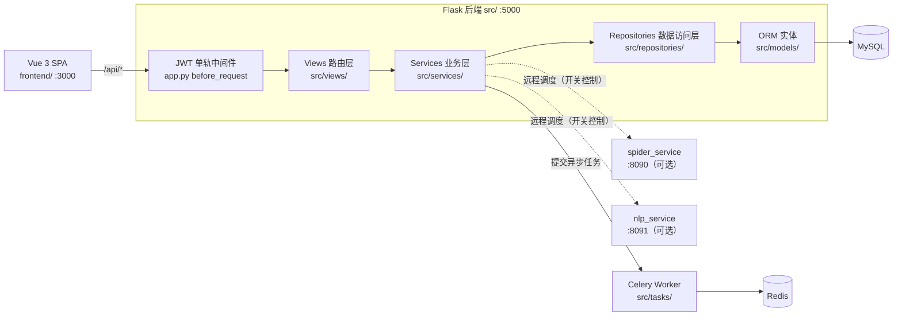

<div align="center">

# 微博舆情分析可视化系统

面向微博数据的采集、情感分析、传播洞察与预警可视化平台

[](https://github.com/zhangjszs/-weibo-sentiment-analysis/actions/workflows/ci.yml)
[](https://github.com/zhangjszs/-weibo-sentiment-analysis/actions/workflows/security-scan.yml)
[](LICENSE.md)
[](pyproject.toml)
[](frontend/package.json)
[](frontend/package.json)
[](requirements/requirements.txt)

</div>

## 目录

- [项目概览](#项目概览)
- [能力边界](#能力边界)
- [技术栈](#技术栈)
- [系统架构](#系统架构)
- [情感分析引擎](#情感分析引擎)
- [快速开始](#快速开始)
- [配置](#配置)
- [容器编排](#容器编排)
- [API 概览](#api-概览)
- [前端页面](#前端页面)
- [项目结构](#项目结构)
- [开发与测试](#开发与测试)
- [可选扩展](#可选扩展)
- [生产部署](#生产部署)
- [已知限制与合规](#已知限制与合规)
- [文档索引](#文档索引)
- [贡献与许可](#贡献与许可)

## 项目概览

本系统以微博公开数据为输入，覆盖 **采集 → 情感分析 → 聚合洞察 → 预警 → 报告导出** 的完整链路：后端是分层架构的 Flask 服务，前端是 Vue 3 单页应用，两者通过统一的 `/api/*` JSON 契约通信。

| 维度 | 说明 |
| --- | --- |
| 项目形态 | Flask 后端（`src/`）+ Vue 3 SPA（`frontend/`），双服务、无共享根包 |
| 数据源 | 微博（真实采集，依赖 `WEIBO_COOKIE`）；其余平台为可选实验能力 |
| 分析内核 | SnowNLP / scikit-learn / BERT-ONNX 三种模型后端可切换并自动降级，另有 LLM 策略（`mode=smart`） |
| 异步任务 | Celery + Redis；本地开发默认不依赖，可直跑 Flask + Vite |
| Schema 真相源 | Alembic 迁移链（`alembic/`），归档 SQL 仅作离线种子与审计对照 |
| 鉴权 | JWT 单轨中间件，Bearer Token 与 `HttpOnly` Cookie 双通道 |
| 交付 | Dockerfile + `docker-compose.yml`（MySQL / Redis / web / worker / frontend / spider / nlp） |
| 质量门禁 | GitHub Actions：后端 lint + 分层 pytest + 覆盖率、前端 lint/format/test/build + 体积预算、Rust fmt/clippy/test |

本地开发不需要 Redis / Celery / Docker；`docker-compose.yml` 用于需要完整异步链路与独立 Spider/NLP worker 的场景。

## 能力边界

能力分级以 [docs/PRODUCT_SCOPE.md](docs/PRODUCT_SCOPE.md) 为准。前端主导航只暴露「正式能力」，实验与运维功能收口在独立分组，演示数据必须显式开启——这样使用者不会把未承诺的能力误当成稳定功能。

**正式能力（v1 主链路）**

- 微博文章 / 评论采集（`src/spider/`）
- 情感分析：SnowNLP + 情感词典 + 启发式规则（`src/services/sentiment_service/`）
- 热词统计与时间趋势、基于评论 IP 的地域分布
- 传播摘要分析（`src/services/propagation_analyzer.py`）
- 报告导出（`src/utils/report_generator.py`，PDF / PPTX）
- 用户认证（JWT + Cookie）、审计日志、预警规则与通知

**实验能力（代码可运行，不承诺数据完整性与接口稳定性）**

- 多平台采集框架：抖音 / 知乎 / B 站 / 微信（`src/services/platform_collectors/`）
- BERT 情感模型：本地 ONNX 推理，需额外下载模型文件
- 上下文情感分析（`src/services/contextual_sentiment.py`）
- 协作标注、WebSocket 实时推送、LLM 增强分析（需外部 API Key）

**演示能力（需显式开关）**

- 演示数据：仅在请求显式带 `demo=true`（或前端 `VITE_DEMO_MODE=true`）时返回；正式模式下真实数据缺失即返回空结果或 `404`，不会静默伪造
- 演示管理员账号：默认关闭，需 `AUTO_CREATE_DEMO_ADMIN=True`

## 技术栈

| 层次 | 技术 |
| --- | --- |
| 后端框架 | Flask 3.1、Flask-CORS、Flask-Compress、Flask-SocketIO、Flask-WTF（CSRF） |
| 数据访问 | SQLAlchemy 2.0、Alembic、PyMySQL；测试环境可切 SQLite |
| 异步任务 | Celery 5.3 + Redis 5 |
| NLP / ML | jieba、SnowNLP、scikit-learn、transformers + torch、ONNX Runtime / Optimum |
| 可视化 | ECharts 6、wordcloud、matplotlib、seaborn |
| 前端 | Vue 3.5、Vite 7、Pinia 3、Vue Router 4、Element Plus 2.13、Axios、socket.io-client |
| 安全 | PyJWT（jti 黑名单撤销）、bcrypt、cryptography、日志脱敏、限流、输入校验 |
| 可观测性 | OpenTelemetry（tracing + metrics，默认关闭、零开销）、prometheus-client |
| 报告 | ReportLab（PDF）、python-pptx |
| 可选 Rust 扩展 | PyO3 + maturin（`rust/weibo_core`，默认自动探测、可回退纯 Python） |
| 工程化 | Black、isort、Ruff、Bandit、pre-commit、pytest、Vitest、ESLint、Prettier |
| 交付 | Docker、Docker Compose、Gunicorn、Nginx、GitHub Actions |

版本约束以 `requirements/requirements.txt`、`requirements/requirements-ml.txt` 与 `frontend/package.json` 为准。

## 系统架构



**请求链路**：`/api/*` → 全局 JWT 单轨中间件（`src/app.py` 的 `before_request`，白名单外一律 401）→ 蓝图路由 → Service → Repository → SQLAlchemy。旧前缀 `/getAllData/*` 保留为先鉴权再 307 跳转的兼容别名（见 [docs/adr/0002-api-prefix-and-auth-unification.md](docs/adr/0002-api-prefix-and-auth-unification.md)），将在下一主版本移除。

**分层职责**：

| 目录 | 职责 |
| --- | --- |
| `src/views/` | 瘦路由层：参数校验、DTO 组装，不写业务逻辑 |
| `src/services/` | 业务逻辑与事务编排，情感分析、预警、传播、报告、采集器均在此 |
| `src/repositories/` | 数据访问封装，唯一的 DB 查询出口 |
| `src/models/` | SQLAlchemy ORM 实体定义 |
| `src/model/` | 离线模型训练、超参优化、数据增强与版本管理（与运行时推理分离） |
| `src/utils/` | 统一响应、鉴权、缓存、限流、分页、加密、日志脱敏等基础设施 |

后端同时保留了一套旧的服务端渲染页面（Jinja2 模板，挂载在 `/user/*` 与 `/page/*`），主界面请使用 Vue SPA。

更完整的架构说明见 [docs/ARCHITECTURE.md](docs/ARCHITECTURE.md)，领域术语见 [CONTEXT.md](CONTEXT.md)，决策记录见 `docs/adr/`。

## 情感分析引擎

情感分析有两条正交的配置轴：**策略**（由请求参数 `mode` 决定）与**模型后端**（由环境变量 `SENTIMENT_BACKEND` 决定）。

**策略路由**（`src/services/sentiment_service/service.py`）

| mode | 策略 | 说明 |
| --- | --- | --- |
| `custom`（默认） | CustomModelStrategy | 走 `SENTIMENT_BACKEND` 指定的模型后端 |
| `simple` | SnowNLPStrategy | SnowNLP + 情感词典兜底，最快、无额外依赖 |
| `smart` | LLMStrategy | 调用外部 LLM，需配置 `LLM_API_KEY` |
| `auto` | 策略选择器 | 按文本特征与后端健康度自适应选择 |
| `contextual` | 上下文分析器 | 结合上下文的实验性特征 |

**模型后端与降级链**（`src/services/sentiment_backend.py`）

`SENTIMENT_BACKEND` 可取 `bert` / `sklearn` / `snownlp` / `auto`（默认）。`auto` 按 **bert → sklearn → snownlp** 逐级降级，保证任一环节缺失时服务仍可用；显式指定 `bert` 时失败会直接抛错，不建议生产使用。

BERT 后端使用 IDEA-CCNL/Erlangshen-Roberta-110M-Sentiment 的 ONNX 导出版（模型名由 `BERT_MODEL_NAME` 配置），首次使用需下载模型：

```bash
python scripts/download_bert_model.py
```

未安装 ML 依赖层（`requirements/requirements-ml.txt`）时，`bert` 与 `sklearn` 后端不可用，`auto` 会降级到 SnowNLP。

## 快速开始

### 环境要求

| 组件 | 版本 | 备注 |
| --- | --- | --- |
| Python | 3.11+ | CI 使用 3.11，`mise.toml` 固定 3.12 |
| Node.js | 20+ | `mise.toml` 固定 22 |
| MySQL | 8.0 | Compose 与 CI 均使用 8.0 |
| Redis | 可选 | 仅异步任务链路需要 |

### 1. 安装依赖

```bash
python -m venv .venv && source .venv/bin/activate   # Windows: .venv\Scripts\activate

# 可选：ML 层（BERT / sklearn 后端所需，CPU 版 torch 避免拉取 CUDA 大包）
pip install -r requirements/requirements-ml.txt \
  --extra-index-url https://download.pytorch.org/whl/cpu

# 运行时依赖 + 开发依赖（测试、lint、alembic）
pip install -r requirements/requirements.txt -r requirements/requirements-dev.txt
```

### 2. 配置环境变量

```bash
cp .env.example .env
```

`.env.example` 是受支持变量的唯一清单，逐项带注释。本地开发至少需要填写 `DB_PASSWORD`；密钥类变量请按文件内提示自行生成，不要提交真实值。

### 3. 初始化数据库

```bash
# 建库
mysql -u root -p -e "CREATE DATABASE IF NOT EXISTS wb CHARACTER SET utf8mb4 COLLATE utf8mb4_unicode_ci;"

# 导入冻结 SQL 建核心表（迁移链 baseline 是空操作，article/comments/user 由该 SQL 创建）
mysql -u root -p wb < docs/database/init_database.sql

# 应用后续迁移（索引补齐、预警表、字段对齐）
alembic upgrade head
```

后续 schema 变更只走 Alembic，禁止再改归档 SQL，规则见 [docs/database/README.md](docs/database/README.md)。

### 4. 启动服务

```bash
# 后端 → http://127.0.0.1:5000
python run.py

# 前端（另开终端）→ http://localhost:3000
cd frontend && npm install && npm run dev
```

Vite 开发服务器已把 `/api` 与 `/user` 代理到 `http://127.0.0.1:5000`；跨机联调时参照 `frontend/.env.example` 建一份本地 env 文件并修改 `VITE_APP_API_BASE_URL`（前端变量需以 `VITE_` 开头才会暴露给客户端）。

**Windows 一键启动**：`scripts/start.bat` 会同时拉起 Flask（5000）与 Vite（3000），`scripts/start.bat stop` 停止。该脚本不包含 Redis / Celery。

### 5. 创建首个账号

系统默认不自动创建任何账号。二选一：

- 开发环境：在 `.env` 中设置 `AUTO_CREATE_DEMO_ADMIN=True`，重启后按 `DEMO_ADMIN_USERNAME` / `DEMO_ADMIN_PASSWORD` 登录
- 常规方式：访问前端 `/register` 或调用公开接口 `/api/auth/register` 注册；需要管理员权限时把用户名加入 `ADMIN_USERS`

### 认证行为

- 登录成功后后端同时返回当前页可用的 Bearer Token，并写入 `HttpOnly` 认证 Cookie
- 前端不把 JWT 持久化到 `localStorage`；刷新页面后通过 Cookie 会话调用 `/api/session/extend` 重新换发内存 Token
- 未认证请求一律 401；已认证的跨站状态变更请求再受 SameSite + Origin 双层校验

## 配置

生产环境（`FLASK_ENV=production`）启动时 `Config.validate()` 会强制校验以下变量，缺失即启动失败：

| 变量 | 要求 |
| --- | --- |
| `SECRET_KEY` | 显式设置的强随机值 |
| `JWT_SECRET_KEY` | 显式设置，且必须不同于 `SECRET_KEY` |
| `ALLOWED_ORIGINS` | 显式列出允许的前端来源 |
| `ADMIN_USERS` | 显式列出管理员用户名 |

其余常用变量（完整清单见 `.env.example`）：

| 变量 | 默认 | 说明 |
| --- | --- | --- |
| `DB_HOST` / `DB_PORT` / `DB_USER` / `DB_PASSWORD` / `DB_NAME` | localhost / 3306 / root / — / weibo_analysis | 本地直连数据库；Compose 内部以 `MYSQL_*` 映射 |
| `TEST_DATABASE_URL` | 空 | 仅测试/CI 使用，优先级高于 `DB_*` |
| `REDIS_URL` | redis://localhost:6379/0 | Celery broker/backend 默认继承此值 |
| `SENTIMENT_BACKEND` | auto | 情感分析模型后端与降级策略 |
| `WEIBO_COOKIE` | 空 | 微博采集凭证，缺失则采集不可用 |
| `SPIDER_SERVICE_ENABLED` / `NLP_SERVICE_ENABLED` | False | 是否把采集 / NLP 调度到独立服务 |
| `DOUYIN_COLLECTOR_ENABLED` 等 | False | 多平台采集开关，关闭时返回模拟数据 |
| `LLM_API_KEY` / `LLM_MODEL` / `LLM_API_URL` | 空 / deepseek-chat / — | `smart` 策略所需，三者须同属一家服务商 |
| `OTEL_ENABLED` | 0 | 开启 OpenTelemetry tracing / metrics |
| `WEIBO_CORE_RUST` | 1 | Rust 扩展自动探测开关，置 0 强制走纯 Python |
| `LOG_LEVEL` / `LOG_SANITIZE_ENABLED` | INFO / True | 日志级别与脱敏（过滤密码、Token、Cookie、邮箱） |
| `AUTO_CREATE_DEMO_ADMIN` | False | 是否创建演示管理员 |

本地直跑读 `DB_*`，Compose 读 `MYSQL_ROOT_PASSWORD` / `MYSQL_DATABASE` / `REDIS_PASSWORD` 并在内部映射为 `DB_*`，两套不要混填。

## 容器编排

```bash
docker compose up -d --build
```

| 服务 | 端口 | 说明 |
| --- | --- | --- |
| `mysql` | 3306 | 业务库（utf8mb4） |
| `redis` | 6379 | Celery broker / result backend |
| `web` | 5000 | Flask 后端 |
| `web-worker` | — | 主应用 Celery worker，消费 `sentiment` / `default` 队列 |
| `frontend` | 3000 | Nginx 托管的构建产物 |
| `spider-api` / `spider-worker` | 8090 | 独立采集服务 |
| `nlp-api` / `nlp-worker` | 8091 | 独立 NLP 服务 |

主后端跑在宿主机、只用容器提供 Spider/NLP 时：

```bash
docker compose up -d --build redis spider-api spider-worker nlp-api nlp-worker
```

并在宿主机 `.env` 中开启 `SPIDER_SERVICE_ENABLED` / `NLP_SERVICE_ENABLED`，把对应的 `*_BASE_URL` 指向 `http://localhost:8090` 与 `http://localhost:8091`。

**可观测性栈**（Jaeger + OTel Collector，默认不启动）：

```bash
docker compose --profile observability up -d
```

Jaeger UI 在 16686，OTLP HTTP 在 4318；应用侧需 `OTEL_ENABLED=1`。当前 trace 链路已验证，metrics 的接收与展示仍有缺口，详见 [docs/OBSERVABILITY.md](docs/OBSERVABILITY.md)。

停止：`docker compose down`。

## API 概览

所有 `/api/*` 接口返回统一结构，`code` 与 HTTP 状态码保持一致，`request_id` 同时写入响应头 `X-Request-Id`：

```json
{
  "code": 200,
  "msg": "success",
  "data": {},
  "timestamp": "2026-02-10T12:00:00+00:00",
  "request_id": "9f3d..."
}
```

| 前缀 | 领域 | 代表接口 |
| --- | --- | --- |
| `/api/auth` | 认证 | 登录、注册、当前用户、登出 |
| `/api/session` | 会话 | 会话检查、Token 续期 |
| `/api/stats`、`/api/articles`、`/api/comments` | 统计与实体 | 概览统计、今日统计、分页列表与筛选 |
| `/api/getHomeData` 等 | 可视化数据 | 首页、表格、文章、评论、IP、舆情、词云、清缓存 |
| `/api/sentiment`、`/api/predict`、`/api/model` | 情感分析与模型 | 单条/批量分析、策略统计与健康度、模型信息、重训练 |
| `/api/spider` | 采集控制 | 概览、爬取、快速爬取、状态、日志、关键词与评论任务 |
| `/api/tasks` | 异步任务 | 任务状态查询 |
| `/api/alert` | 预警 | 规则增删改查与开关、历史、统计、未读数、评估、测试 |
| `/api/propagation` | 传播分析 | 路径分析、关系图、KOL 影响力、时间线、深度分布、多路径对比 |
| `/api/report` | 报告 | 生成、全格式生成、下载、预览、模板列表、数据源 |
| `/api/platform` | 多平台 | 平台列表、平台数据、汇总、统计、对比 |
| `/api/bigscreen` | 数据大屏 | 统计、地域、趋势、热门话题、最近预警 |
| `/api/favorites` | 收藏 | 增删、单条校验、批量校验 |
| `/api/audit` | 审计 | 审计日志查询 |
| `/api/v1` | 版本化分析 | 统一分析入口 |
| `/health`、`/ready` | 探针 | liveness（无 I/O）、readiness（带超时依赖检查） |

可视化数据接口的服务端内存缓存时长：首页 5 分钟、表格 3 分钟、文章 10 分钟、评论 5 分钟、IP 10 分钟、舆情 5 分钟、词云 30 分钟；可通过 `/api/clearCache` 手动清理。

预警类型覆盖 `volume_spike`、`negative_surge`、`sentiment_shift`、`keyword_match`、`hot_topic`、`threshold_breach`、`custom`；通知渠道支持 email、SMS、WebSocket。

完整接口定义（请求体、参数、响应示例）见 [docs/API.md](docs/API.md)。

## 前端页面

路由按 `meta.group` 分为两组，与能力边界一一对应（定义见 `frontend/src/router/index.js`）。

**分析主线（`analysis`）**

| 路径 | 页面 |
| --- | --- |
| /home | 话题分析 |
| /sentiment-analysis | 趋势 / 情感 |
| /article-analysis | 文章分析 |
| /comment-analysis | 评论分析 |
| /propagation | 传播分析 |
| /report | 报告导出 |

**实验 / 运维（`lab`）**

| 路径 | 页面 | 权限 |
| --- | --- | --- |
| /hot-words | 热词统计 | 登录 |
| /weibo-stats | 微博舆情统计 | 登录 |
| /ip-analysis | IP 分析 | 登录 |
| /predict | 内容预测 | 登录 |
| /word-cloud | 词云图 | 登录 |
| /spider | 爬虫管理 | 管理员 |
| /alert-center | 预警中心 | 登录 |
| /big-screen | 数据大屏 | 登录 |
| /platform-monitor | 多平台监测 | 登录 |
| /tasks | 任务中心 | 管理员 |

另有 /profile（个人中心）、/favorites（我的收藏）、/help（帮助中心），以及 /login、/register 与 403 / 404 / 500 错误页。管理员页面在非管理员访问时跳转 /403。

> 仓库当前未收录产品截图，界面以本地运行为准。

## 项目结构

```text
weibo-sentiment-analysis/
├── src/                        # Flask 后端
│   ├── app.py                  # 应用工厂：中间件、蓝图注册、错误处理、探针
│   ├── database.py             # SQLAlchemy engine / session / Base
│   ├── config/                 # 配置加载与生产校验（settings.py）
│   ├── views/                  # 路由层：api/ 领域接口，page/ 与 user/ 旧模板页
│   ├── services/               # 业务层：情感分析、预警、传播、报告、采集器
│   ├── repositories/           # 数据访问层
│   ├── models/                 # ORM 实体
│   ├── model/                  # 离线模型训练、超参优化、版本管理
│   ├── spider/                 # 微博采集模块
│   ├── tasks/                  # Celery 配置与任务
│   ├── utils/                  # 统一响应、鉴权、缓存、限流、脱敏等
│   ├── static/                 # 旧版页面静态资源
│   ├── templates/              # 全局错误页模板
│   └── logs/                   # 运行日志（Config.LOG_DIR）
├── frontend/                   # Vue 3 + Vite 单页应用（含 Vitest 用例）
├── spider_service/             # 可选：独立采集服务（Flask + Celery，:8090）
├── nlp_service/                # 可选：独立 NLP 服务（Flask + Celery，:8091）
├── rust/weibo_core/            # 可选：PyO3 扩展（含 criterion 基准）
├── alembic/                    # 数据库迁移（schema 变更唯一入口）
├── docs/                       # 架构 / API / 部署 / ADR / 基准数据
├── scripts/                    # 运维与开发脚本
├── tests/                      # 后端 pytest 用例
├── requirements/               # 分层依赖：ml / runtime / dev
├── run.py                      # 后端入口（Gunicorn 挂载点 run:app）
├── docker-compose.yml          # 全栈编排
├── pytest.ini                  # pytest 标记与门禁（唯一真相源）
└── .env.example                # 环境变量清单
```

运行时目录：`data/`（数据文件）、`cache/`（缓存）、`src/logs/`（日志）。

## 开发与测试

### 质量门禁

```bash
# 后端快速门禁：lint + unit/api 测试（无需外部服务）
python -m ruff check src tests scripts && python -m pytest -m "unit or api" -q --maxfail=1

# 前端完整门禁
cd frontend && npm ci && npm run lint && npm run format:check && npm run test:run && npm run build && npm run check:bundle

# Windows 全量校验脚本
pwsh -NoProfile -File scripts/verify_project.ps1
```

执行 `pre-commit install` 后，提交时会自动跑 Black、isort、Ruff、Bandit 与一组通用文件检查。

### 代码风格

- Python：Black（line-length 88）、isort（profile=black）、Ruff（`E,W,F,I,B,C4,UP`，忽略 `E501,B008,B905`），配置集中在 `pyproject.toml`
- 前端：ESLint + Prettier，格式规则归属 Prettier，ESLint 侧已关闭冲突的纯格式规则
- 详见 [docs/CODING_STANDARDS.md](docs/CODING_STANDARDS.md)

### 测试分层

`pytest.ini` 定义了严格的标记体系，裸跑 `pytest` 会执行全部层次（其中多数需要 MySQL / Redis / 微博 Cookie），日常请按层选择：

| 标记 | 含义 | 命令 |
| --- | --- | --- |
| `unit` | 纯逻辑，无外部依赖 | `pytest -m unit -q` |
| `api` | Flask 测试客户端，内存应用 | `pytest -m api -q` |
| `integration` | 需要真实数据库（SQLite 或 MySQL） | `pytest -m integration -q` |
| `external` | 需要 Redis / 微博 Cookie / 远程 NLP | `pytest -m external -q` |
| `slow` | 性能与压力测试 | `pytest -m slow -q` |

`tests/conftest.py` 会为整个测试会话自动设置 `TEST_DATABASE_URL=sqlite:///:memory:`，并把 Celery 切到内存 broker + `task_always_eager=True`，因此 unit / api 层无需任何外部服务。前端测试用 Vitest，`npm run test:coverage` 可产出覆盖率报告。

### CI

`.github/workflows/ci.yml` 在 push（main / develop）与 PR（main）时运行四个 job：

- **backend-fast**：文档死链门禁（`scripts/check_documented_paths.py`）→ Ruff → unit/api 测试 + 覆盖率门禁 + 慢用例 Top10 写入 step summary
- **frontend-fast**：lint → format check → Vitest → build → 首屏体积预算（`frontend/bundle-budget.json`）
- **integration**：拉起 MySQL 8.0 + Redis 7 服务容器，导入 SQL 并跑 `alembic upgrade head`，再执行 integration 层用例，产出覆盖率制品
- **rust-core**：cargo fmt / clippy（`-D warnings`）/ test → maturin release 构建 → 冒烟导入

`.github/workflows/security-scan.yml` 在同一触发条件外加每周一凌晨定时执行安全扫描。

## 可选扩展

### Rust 扩展（weibo_core）

`rust/weibo_core` 是基于 PyO3 + maturin 的可选扩展，覆盖文本 normalize 与去重等纯函数切片。**不构建不影响任何功能**：适配层 `src/services/rust_bridge` 默认自动探测，扩展缺失或抛错时回退纯 Python 参考实现，也可用 `WEIBO_CORE_RUST=0` 强制禁用。

前置条件：rustup 可用（工具链由 `rust/rust-toolchain.toml` 固定为 1.99.0 + rustfmt + clippy，仅在 `rust/` 目录下生效），Python 侧已安装 maturin（产物为 abi3-py3.11 wheel，Python 3.11 / 3.12 均可安装）。

```bash
# 方式一：脚本（等价于 maturin develop --release）
bash scripts/build_rust.sh

# 方式二：手动（在项目 venv 中执行）
cd rust/weibo_core
python -m maturin develop --release
# 或构建 wheel 并本地安装（wheel 仅本地/CI 使用，不发布 PyPI）
python -m maturin build --release
python -m pip install --force-reinstall target/wheels/weibo_core-*.whl

# 冒烟
python -c "import weibo_core; print(weibo_core.version())"
```

> `maturin develop` 不带 `--release` 时是未优化的 dev 构建，比 release 慢约 20 倍，日常使用与基准测量必须带 `--release`。

**关于性能**：当前已迁移的切片均为 CPython 本身已是 C 实现的薄字符串操作，实测受 FFI marshaling 主导，**全部慢于纯 Python 实现**（dedup 0.24–0.63x、normalize 逐条 0.72x / 批量 0.96x，倍数越低越慢，数据见 [docs/benchmarks/m7-1-dedup.md](docs/benchmarks/m7-1-dedup.md)）。因此该扩展目前的价值在于 FFI 边界工程实践与契约等价性保障，而非吞吐收益；后续切片必须先 profile，目标锁定「Rust 自有 buffer 上的重计算」或「纯 Python 慢循环」。范围与决策见 [docs/adr/0005-rust-accelerator-scope.md](docs/adr/0005-rust-accelerator-scope.md)。

### OpenTelemetry

默认关闭、零导入开销；`OTEL_ENABLED=1` 后启用 tracing 与 metrics，导出失败永远降级为无观测，不阻断启动与请求。无 Docker 也能本地演示：

```bash
OTEL_ENABLED=1 OTEL_EXPORTER_OTLP_ENDPOINT=console python scripts/demo_otel_trace.py
```

配置项与实测 trace 样本见 [docs/OBSERVABILITY.md](docs/OBSERVABILITY.md)。

## 生产部署

推荐 Gunicorn 挂载 Flask 后端、Nginx 代理前端构建产物：

```bash
# 后端（run.py 已暴露 app 对象）
gunicorn -w 2 -b 0.0.0.0:5000 run:app

# 前端
cd frontend && npm ci && npm run build   # 产物在 frontend/dist
```

前端镜像内含 `frontend/nginx.conf`，Compose 的 `frontend` 服务即以此托管。部署前请确认：

- `FLASK_ENV=production`，且 `SECRET_KEY` / `JWT_SECRET_KEY` / `ALLOWED_ORIGINS` / `ADMIN_USERS` 均已显式设置（否则启动即失败）
- 容器启动前执行 `alembic upgrade head`
- `AUTO_CREATE_DEMO_ADMIN` 保持 False，演示口令不出现在生产环境
- 健康探针指向 `/health`（liveness）与 `/ready`（readiness）

完整步骤、Nginx 配置与回滚方案见 [docs/DEPLOYMENT.md](docs/DEPLOYMENT.md) 与 [docs/LOCAL_DEPLOYMENT.md](docs/LOCAL_DEPLOYMENT.md)，发版检查清单见 [docs/RELEASE_CHECKLIST.md](docs/RELEASE_CHECKLIST.md)。

## 已知限制与合规

- **采集合规风险**：微博采集依赖个人 `WEIBO_COOKIE`，属于灰色地带，请自行评估目标站点的服务条款与当地法律；提高并发会增加 IP 被封风险。本仓库不提供任何绕过反爬的手段，默认请求延时为 15 秒（实际在 DELAY ~ DELAY×2 间随机，由 `SPIDER_DELAY` 控制）。
- **多平台数据默认为模拟**：抖音 / 知乎 / B 站 / 微信采集器默认关闭，未启用时返回模拟数据；其中抖音采集因需要签名算法尚未实现。前端展示时应标注数据来源。
- **演示数据必须显式开启**：正式模式下真实数据缺失会返回空结果或 `404`，不会静默回退为 demo 内容。
- **Rust 扩展无性能收益**：见上文实测数据，不要将其作为性能优化手段引入。
- **BERT 后端需额外模型文件**：未下载 ONNX 模型时 `auto` 会降级到 sklearn 或 SnowNLP。
- **两套前端并存**：Vue SPA 是主界面，`/user/*` 与 `/page/*` 下的 Jinja2 页面为历史遗留，仍受同一套 JWT 单轨鉴权约束。
- **可观测性 metrics 链路未完成**：trace 已验证，metrics 的接收与展示仍有缺口。

## 文档索引

| 主题 | 文档 |
| --- | --- |
| 领域术语与架构总览 | [CONTEXT.md](CONTEXT.md)、[docs/ARCHITECTURE.md](docs/ARCHITECTURE.md) |
| 接口契约 | [docs/API.md](docs/API.md) |
| 产品能力边界 | [docs/PRODUCT_SCOPE.md](docs/PRODUCT_SCOPE.md) |
| 用户流程 | [docs/USER_FLOWS.md](docs/USER_FLOWS.md) |
| 开发指南 | [docs/DEVELOPMENT.md](docs/DEVELOPMENT.md)、[docs/CODING_STANDARDS.md](docs/CODING_STANDARDS.md) |
| 部署 | [docs/DEPLOYMENT.md](docs/DEPLOYMENT.md)、[docs/LOCAL_DEPLOYMENT.md](docs/LOCAL_DEPLOYMENT.md) |
| 数据库与迁移 | [docs/database/README.md](docs/database/README.md)、`docs/adr/` |
| 数据治理与审计 | [docs/DATA_GOVERNANCE.md](docs/DATA_GOVERNANCE.md) |
| 可观测性 | [docs/OBSERVABILITY.md](docs/OBSERVABILITY.md) |
| 上下文情感分析 | [docs/CONTEXTUAL_SENTIMENT.md](docs/CONTEXTUAL_SENTIMENT.md) |
| 测试与性能 | [docs/TEST_PERF.md](docs/TEST_PERF.md)、[docs/benchmarks/m7-1-dedup.md](docs/benchmarks/m7-1-dedup.md) |
| 变更记录 | [docs/CHANGELOG.md](docs/CHANGELOG.md) |
| Agent 协作约定 | [AGENTS.md](AGENTS.md)、`docs/agents/` |

## 贡献与许可

贡献流程、分支约定与提交规范见 [docs/CONTRIBUTING.md](docs/CONTRIBUTING.md)。简要步骤：

1. Fork 仓库并创建功能分支
2. 本地跑通对应层的质量门禁（见[开发与测试](#开发与测试)）
3. 提交 Pull Request，说明动机、影响范围与验证方式

问题与建议请提交 [Issue](https://github.com/zhangjszs/-weibo-sentiment-analysis/issues)。

本项目基于 [MIT License](LICENSE.md) 开源。
